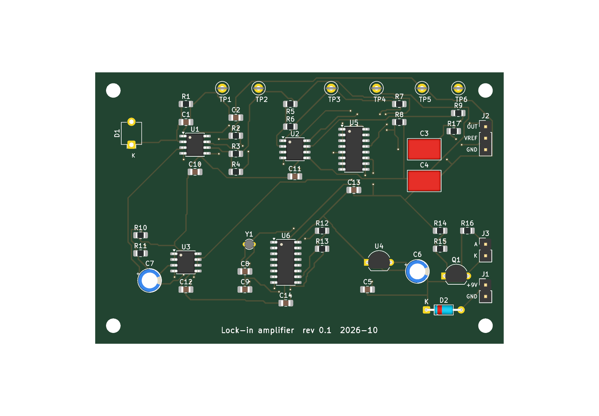

# Optical lock-in amplifier for photodiode sensing

A complete optical lock-in amplifier, designed, simulated, laid out, assembled and tested by me in October 2026. An LED blinks at 1,024 Hz, a BPW34 photodiode picks up that light together with much stronger room light and lamp flicker, and the circuit outputs a DC voltage that follows only the light blinking in step with the LED.


## Signal chain

```
 9 V battery -> protection diode -> 5 V regulator -> 2.5 V virtual ground (buffered)

 32.768 kHz crystal -> 74HC4060 divider -> 1,024 Hz reference --+--> MOSFET -> LED
                                                              |
 photodiode -> [1 TIA] -> [2 high pass + gain 11] -> [3 +1/-1 switch] -> [4 low pass] -> buffer -> output
                                                              ^
                                                     reference controls switch
```

1. **Transimpedance amplifier.** 100 kΩ and 100 pF turn photodiode current into voltage, with a 15.9 kHz bandwidth.
2. **High pass filter and gain.** A 159 Hz corner blocks the ambient DC and halves 100 Hz flicker, then a gain of 11. More gain would clip the flicker against the 5 V rail.
3. **Synchronous demodulator.** A 74HC4053 switch flips an op amp between gain +1 and −1 in time with the LED, so the wanted signal becomes DC and everything else averages to zero.
4. **Low pass output.** Two RC sections at 1.6 Hz each, then a buffer. A new reading settles in about one second.

The full reasoning, stage by stage, with the error budget and noise analysis, is in [DESIGN.md](DESIGN.md).

## Simulation

Simulated in LTspice with a generic op amp model and again in ngspice with Microchip's own MCP6021 model. Interference in every run: 5 µA of steady ambient light plus 1 µA of 100 Hz flicker.

| Photodiode signal | Output |
|---|---|
| 0 nA | 0.000 mV |
| 10 nA | 5.22 mV |
| 100 nA | 52.19 mV |

Sensitivity is 0.522 mV per nA, with 0.05 mV of output ripple. Calculated noise is 1.33 pA/√Hz, set by the ambient light rather than the electronics, and the noise simulation agrees with the hand calculation to within 1 %.

The ngspice run with the real op amp model caught a problem the generic model hid: the analog switch was kicking 0.2 V spikes onto the 2.5 V reference at every edge. Feeding the switch from the spare op amp half as a buffer dropped the output ripple from 222 mV to 2.4 mV, at no cost in parts.

## Measured results

**Breadboard, 15 October 2026.** LED next to the photodiode: 176 mV in a dark room, 178 mV with dim outside light added (about 1 %). LED removed: 0.0 mV. The output followed the LED and ignored the room.


**Circuit board, 27 and 28 October 2026.** Soldered stage by stage with a multimeter check after each one: 5 V regulator at 4.90 V, reference at 2.45 V, clock running. Final test on the output against the reference:

| Condition | Output |
|---|---|
| LED covered or away | 0.00 mV |
| LED almost touching the photodiode | 362 mV |
| LED a little higher | 90 mV |
| LED higher again | 40 mV |

With the LED held at about 90 mV, switching between normal room light, a phone torch and a darker room moved the output by only 2 to 3 %, which is within how still the LED could be held by hand. The board reproduces the breadboard result with a stronger signal.

| | |
|---|---|
|  |  |

## Board

90 x 60 mm, two copper layers, made by PCBWay. The KiCad schematic and board are generated by scripts in [`kicad/`](kicad), checked with ERC, DRC and a netlist comparison against [`kicad/expected_nets.json`](kicad/expected_nets.json).



## What's in here

| Path | What it is |
|---|---|
| [`DESIGN.md`](DESIGN.md) | Design notes, simulation results, error budget and noise |
| [`BUILD-GUIDE.md`](BUILD-GUIDE.md) | Soldering the board in stages, with the check after each one |
| [`BREADBOARD-GUIDE.md`](BREADBOARD-GUIDE.md) | Building the proof of concept on a breadboard |
| [`BUY-LIST.txt`](BUY-LIST.txt) | Parts list |
| [`sim/`](sim) | LTspice and ngspice netlists, logs and run scripts |
| [`kicad/`](kicad) | Schematic, board, Gerbers, BOM and the scripts that generate them |
| [`breadboard/`](breadboard) | Breadboard layout |
| [`case/`](case) | 3D printed case in OpenSCAD, with STL files |
| [`3d-view/`](3d-view) | Interactive 3D view of the board in its case |

The ngspice runs use Microchip's MCP6021 PSpice model, which is not redistributed here. Download it from the MCP6021 product page on microchip.com and save it as `sim/mcp6021_model/MCP6021.txt`.

## Tools

KiCad, LTspice, ngspice, OpenSCAD, Python, a soldering iron and a DT-830B multimeter.
