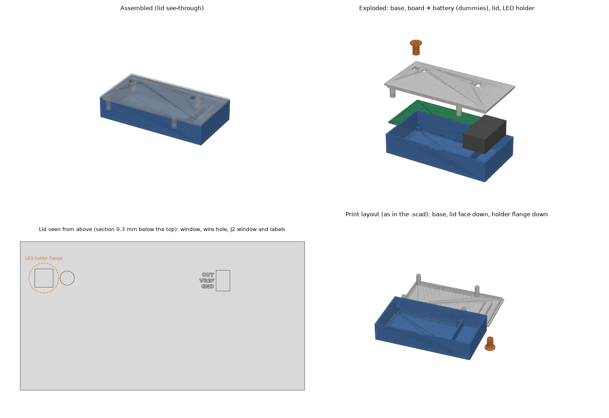

# Lock-in amplifier case

Three printed parts, no screws, no extra parts. The board is held by pins and the lid; the battery lies
in its own bay; the LED sits in a holder that puts its tip 3 mm above the photodiode every time.

DRAFT: never printed. Positions come from the board file; heights are estimates. Before printing,
check the numbers under "Measure first" against the assembled board.



## Files

| File | What |
|---|---|
| `lockin-base.stl` | Base tray with 4 standoffs and pins, battery bay, divider. 123.9 x 64.8 x 23.6 mm |
| `lockin-lid.stl` | Lid, already turned over for printing. 123.9 x 64.8 x 17.0 mm (2 mm plate + 15 mm tubes) |
| `lockin-led-holder.stl` | LED holder, flange down. 13.0 x 13.0 x 14.1 mm |
| `lockin-case.scad` | OpenSCAD source (all numbers at the top) |
| `make_case_stl.py` | Builds the same STLs without OpenSCAD (Python: numpy, trimesh, manifold3d, matplotlib) |

Closed case: 123.9 x 64.8 x 25.6 mm. The parts need a bed of at least 125 x 66 mm.

## Printing

PLA, 0.2 mm layers, 20 % infill, 3 perimeters (walls), no supports, no brim needed.

- Base: floor down, as in the file.
- Lid: outer (top) face down, as in the file. The labels are engraved into this face; they print as
  recesses in the first layers. The lip, tubes and ribs point up.
- LED holder: flange down, as in the file. Print it at least twice, it is small and cheap; keep the one
  whose tube slides into the lid window without force.

## Measure first (and change the number at the top of the .scad / .py if needed)

- `top_h = 15`: space above the board. Measured 2026-10-28: tallest part 13 mm.
- `d1_h = 1.5`: top of D1 above the board. The LED tip ends `led_gap = 3` mm above this. If D1 sits
  higher (legs not pushed fully in), the LED ends closer than 3 mm.
- `led_len = 7.6`: LED from the dome tip to the underside of its rim. 5 mm LEDs vary from about 7.5 to 8.7 mm.
- Underside: solder joints and cut legs must be shorter than the 5 mm standoffs.

To change the LED distance, edit `led_gap` and regenerate only the holder (a few holders with
different gaps, e.g. 1, 3 and 5 mm, give repeatable readings at each distance).

## J2 output (no soldering)

The lid has one window over J2's three header pins, with OUT, VREF and GND engraved beside it. The pin
tips are 8.5 mm below the lid top: put the multimeter probes in through the window onto the pins.

## Assembly

1. Nothing to solder. The battery clip wires stay in J1 and the LED wires in J3.
2. Put the board into the base, component side up, the J1/J2/J3 edge towards the battery bay,
   with the four pins through the mounting holes.
3. Lay the battery flat in the bay. Lead the clip wires over the divider through its notch.
4. Before the lid goes on, push the LED (on its wires from J3) up through the lid's 6.2 mm hole
   beside the window, from the inside. (The hole is 6.2 mm, not 4 mm, so the LED's 5.8 mm rim fits through.)
5. Press the lid on: lip into the base, J2 under its window. The four tubes under the lid
   land on the board around the mounting holes and clamp it.
6. Put the LED holder's tube into the window over D1. Drop the LED in from the top, dome down, until
   its rim rests on the step inside. Do not cut the LED legs short: the legs and wires come out of the
   top of the holder and go into the hole beside it.
7. Read with the probes through the J2 window: OUT (+) and VREF (-).

To change the battery, pull the lid off (finger notch in the front wall), take the LED holder out first.

LED wire length: J3 to the wire hole is about 75 mm in a straight line, plus about 15 mm up through
the holder, so 10 cm of wire is just enough. Route it straight across inside, not around the walls.

If the lid is loose, a layer of tape on the lip fixes it; if it is too tight, sand the lip.

## Regenerating the STLs without OpenSCAD

```
python -m venv venv
venv\Scripts\python -m pip install numpy trimesh manifold3d matplotlib
venv\Scripts\python make_case_stl.py
```

It prints each part's size, checks that each STL is watertight, and checks that the parts do not overlap
when assembled.
